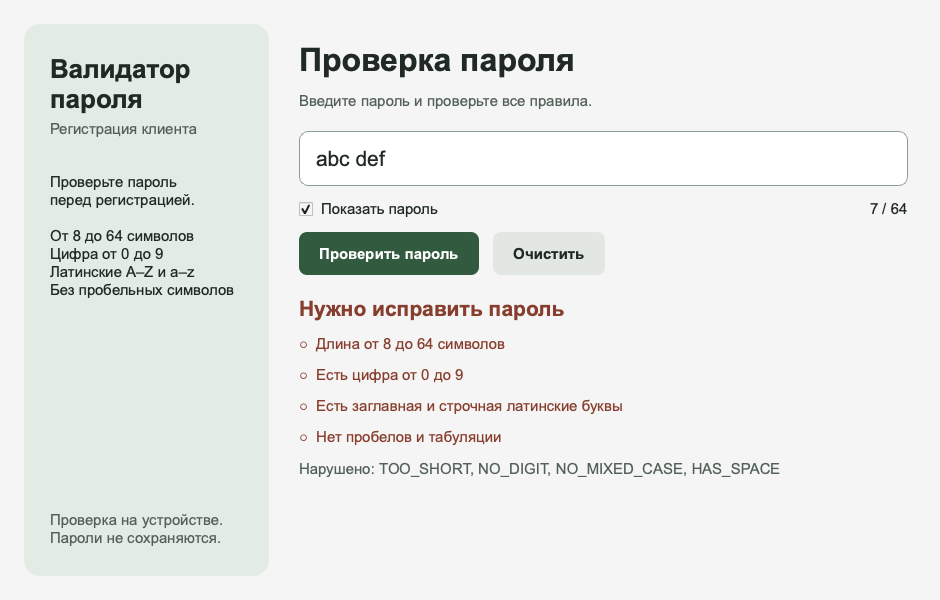

<div align="center">

# Валидатор пароля

**Приложение на C++17 и Qt 6, которое объясняет каждое нарушение правил пароля.**

[](https://github.com/8gw7b6dzgg-create/password-validator/actions/workflows/build.yml)


[Скачать программу](https://github.com/8gw7b6dzgg-create/password-validator/releases/latest) · [Отчёт PDF](report.pdf) · [Отчёт Word](report.docx)

</div>


## Возможности

- Проверка при вводе с отдельной подсказкой для каждого правила.
- Показ и скрытие пароля, счётчик символов и очистка поля.
- Повторно используемый модуль без ввода и вывода.
- Консольная демонстрация пяти сценариев из задания.
- 17 автоматических проверок, включая все 12 обязательных сценариев.
- Отчёт на 3 страницы со скриншотами в PDF и Word. Текст отчёта — чёрный.

Пароли обрабатываются на устройстве, не сохраняются и не передаются по сети.
Программа проверяет учебные правила; она не оценивает криптографическую стойкость пароля.

## Правила проверки

| Правило | Условие | Код нарушения |
| --- | --- | --- |
| Минимальная длина | Не меньше 8 символов | `TOO_SHORT` |
| Максимальная длина | Не больше 64 символов | `TOO_LONG` |
| Цифра | Есть символ от `0` до `9` | `NO_DIGIT` |
| Регистр | Есть латинские `A–Z` и `a–z` | `NO_MIXED_CASE` |
| Пробельные символы | Нет пробела, табуляции и других символов `QChar::isSpace` | `HAS_SPACE` |

Нарушения возвращаются в порядке строк таблицы. Пустой список означает, что пароль принят.
Длина считается в кодовых точках Unicode. Кириллица не заменяет латинские буквы при проверке регистра.

<details>
<summary>Пример с несколькими нарушениями</summary>



Строка `abc def` возвращает `TOO_SHORT`, `NO_DIGIT`, `NO_MIXED_CASE`, `HAS_SPACE`.

</details>

## Запуск

Готовая сборка **для macOS Apple Silicon** находится в [релизах](https://github.com/8gw7b6dzgg-create/password-validator/releases/latest).
Распакуйте архив и откройте `password_gui.app`.
Сборка не нотарифицирована Apple.

Для Windows, Linux и других конфигураций macOS соберите проект из исходников.

### Через Qt Creator

1. Установите Qt 6 с модулями Core и Widgets и компилятор C++17.
2. Откройте `CMakeLists.txt` в Qt Creator.
3. Выберите комплект Qt, соберите проект и запустите `password_gui`.

### Через терминал

Требуются CMake 3.16+, компилятор C++17 и Qt 6.
Если CMake не находит Qt автоматически, укажите каталог комплекта Qt через `CMAKE_PREFIX_PATH`.

```sh
cmake -S . -B build -DCMAKE_BUILD_TYPE=Release -DCMAKE_PREFIX_PATH="путь/к/Qt/6.x/комплекту"
cmake --build build --config Release
ctest --test-dir build -C Release --output-on-failure
```

| Цель | Назначение |
| --- | --- |
| `password_gui` | Графическое приложение |
| `password_demo` | Пять примеров интеграции |
| `password_tests` | 17 автоматических тестов |

В многоконфигурационных сборках исполняемые файлы находятся в `build/Release`.
На macOS интерфейс собирается как `build/password_gui.app`.

## Подключение модуля

Добавьте `src/password_validator.cpp` и заголовочный файл в свой проект и подключите `Qt6::Core`.

```cpp
#include "password_validator.h"

auto errors = password_validator::validate_password(QString("Sport2024"));
// errors.isEmpty() == true
```

| Функция | Результат |
| --- | --- |
| `check_length(password, min, max)` | Допустима ли длина |
| `has_digit(password)` | Есть ли цифра 0–9 |
| `has_upper_and_lower(password)` | Есть ли оба латинских регистра |
| `contains_space(password)` | Есть ли пробельный символ |
| `validate_password(password)` | `QStringList` с кодами нарушений |

Функции принимают `QVariant` и проверяют типы во время выполнения.
Передавайте строку как `QString`, а границы длины как `int`.
Неверный тип, `min < 1` или `max < min` вызывает `std::invalid_argument("ERR_INVALID_ARGUMENT")`.

## Проверки и документация

Первые 12 тестов соответствуют ТЗ. Дополнительные тесты проверяют длину 65,
табуляцию, Unicode и неверные типы параметров.

- [Протокол локального запуска — 17 PASS, 0 FAIL](test_protocol.txt)
- [Вывод консольной демонстрации](demo_output.txt)
- [Отчёт PDF](report.pdf)
- [Отчёт Word](report.docx)
- [Автоматическая сборка и тесты на Linux](https://github.com/8gw7b6dzgg-create/password-validator/actions)

```text
src/
  password_validator.h    Публичный интерфейс модуля
  password_validator.cpp  Реализация правил
  main.cpp                Графическое приложение
  demo.cpp                Консольная демонстрация
 tests/
  tests.cpp               Автоматические проверки
screenshots/              Снимки работающего приложения
CMakeLists.txt            Настройки сборки
```
