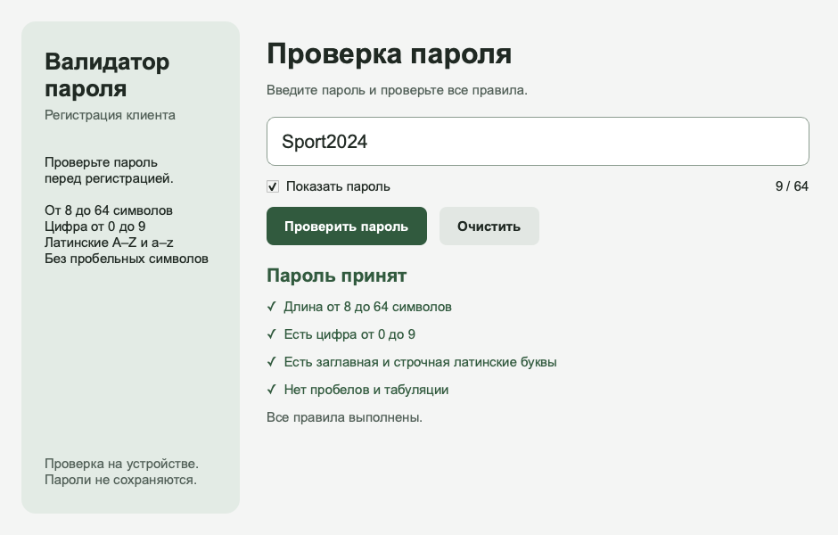

# Валидатор пароля

Учебный модуль C++17 / Qt 6 по ТЗ «Валидатор пароля».

## Интерфейс


## Отчёт
- [Отчёт PDF](report.pdf)
- [Отчёт Word с чёрным текстом](report.docx)

## Готовая программа
В разделе Releases находится сборка для macOS Apple Silicon и архив исходников.
Для Windows и Linux проект собирается из исходного кода.

## Сборка (Windows, Linux, macOS)
Установите компилятор C++17, CMake 3.16+ и Qt 6 с модулями Core и Widgets.
Для Windows рекомендуется Qt Creator с комплектом Qt 6 MinGW либо MSVC.
Откройте CMakeLists.txt в Qt Creator, выберите установленный комплект и нажмите «Собрать», затем запустите password_gui.

Из терминала:
```
cmake -S . -B build -DCMAKE_PREFIX_PATH="путь/к/Qt/6.x/комплекту"
cmake --build build --config Release
ctest --test-dir build -C Release --output-on-failure
```
Исполняемые файлы: password_gui (интерфейс), password_demo (пять примеров), password_tests (17 проверок).
Для генераторов с несколькими конфигурациями они находятся в build/Release.
На macOS графическая программа может собираться как build/password_gui.app.

## Использование
Введите пароль. Подсказки обновляются сразу; кнопку «Проверить пароль» также можно вызвать Enter.
«Показать пароль» переключает маскировку, «Очистить» очищает ввод.
Пароли не записываются в файл и не передаются по сети.
Проверка означает только выполнение учебных правил, а не оценку стойкости пароля.

## Подключение модуля
Добавьте src/password_validator.cpp и src/password_validator.h в проект, подключите Qt6::Core.
```
#include "password_validator.h"
auto errors = password_validator::validate_password(QString("Sport2024"));
// errors.isEmpty() == true
```
Функции принимают QVariant для проверки типов во время выполнения.
Строка передаётся как QString (не как литерал const char*).
Параметры длины имеют тип int. Другие типы, min < 1 и max < min
вызывают std::invalid_argument("ERR_INVALID_ARGUMENT").

check_length(password, min, max) -> bool
has_digit(password) -> bool
has_upper_and_lower(password) -> bool
contains_space(password) -> bool
validate_password(password) -> QStringList

Длина считается в кодовых точках Unicode, без обрезки и нормализации строки.
Цифры: только 0–9. Регистр: только A–Z и a–z.
Пробельные символы определяются QChar::isSpace (включая пробел и табуляцию).
Порядок нарушений: TOO_SHORT, TOO_LONG, NO_DIGIT, NO_MIXED_CASE, HAS_SPACE.

## Проверенные результаты
В test_protocol.txt записан реальный запуск: 17 PASS, 0 FAIL.
Первые 12 тестов соответствуют таблице ТЗ; остальные проверяют дополнительные границы.
В demo_output.txt находится вывод интеграционных примеров.
В screenshots — снимки реального окна с публичными учебными строками.

## Состав
src/ — модуль, графический интерфейс и консольная демонстрация.
tests/ — автономный тестовый исполняемый файл без внешнего тестового фреймворка.
report.docx и report.pdf — трёхстраничный отчёт со скриншотами.
